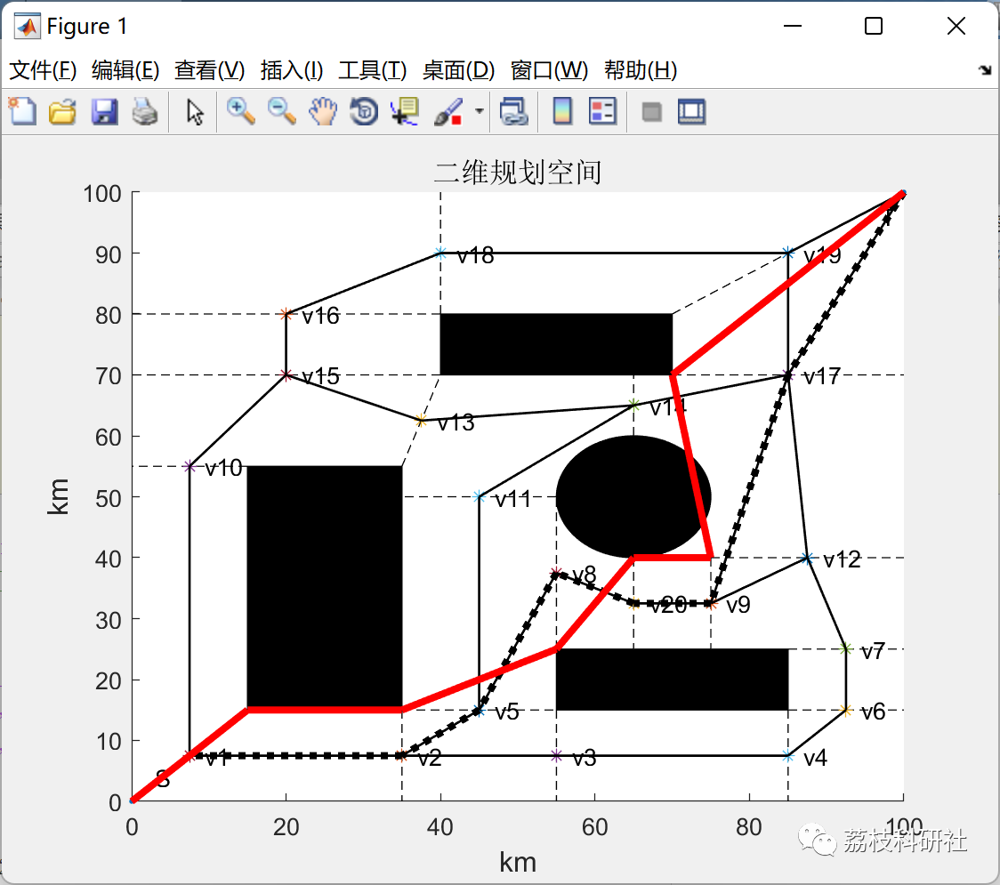
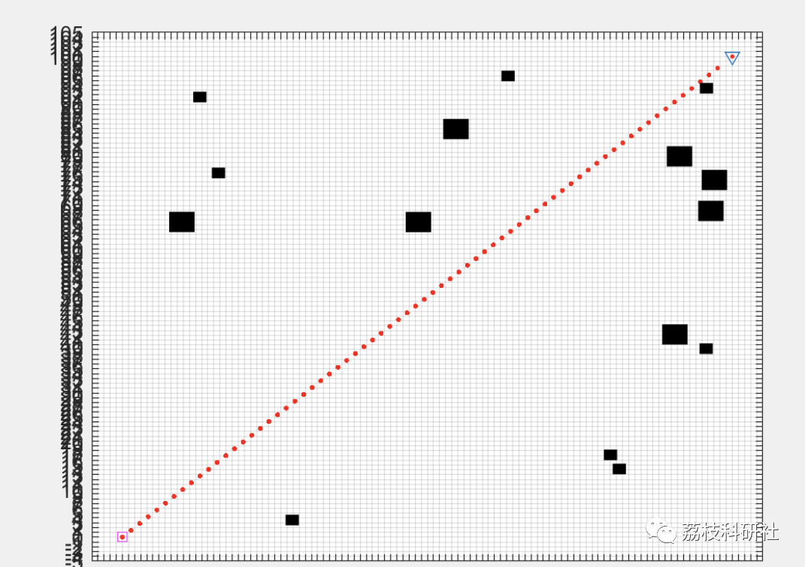
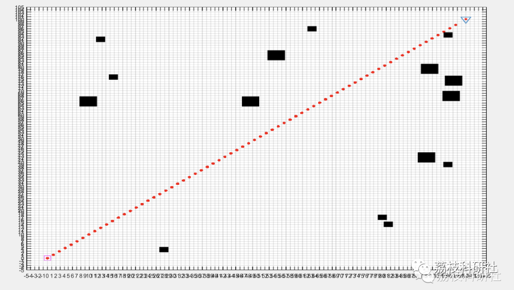
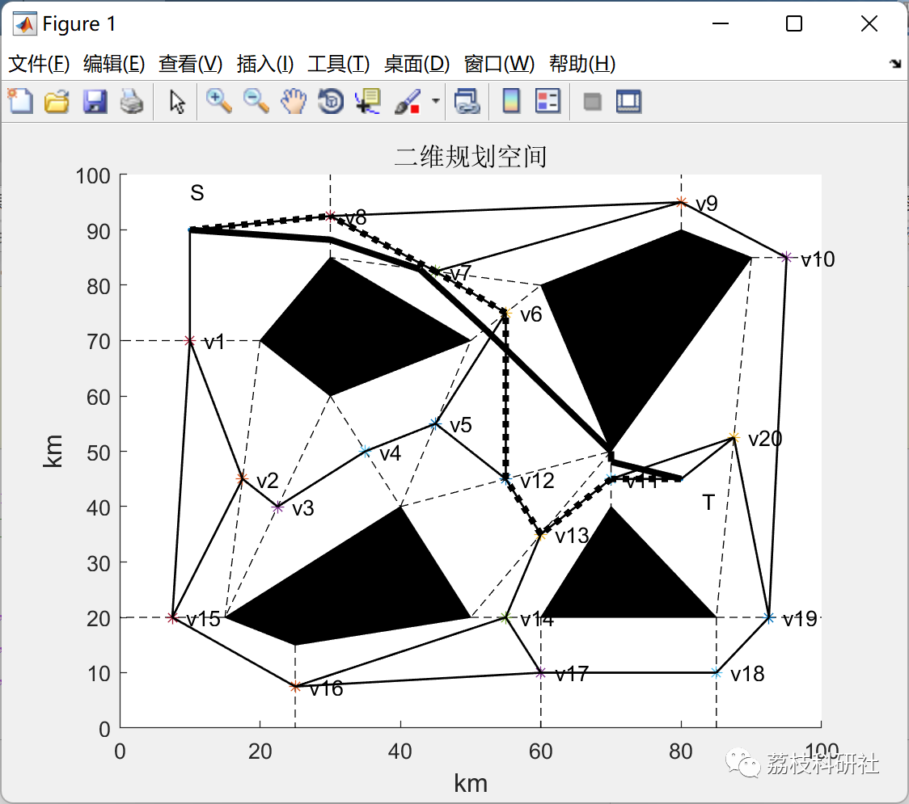
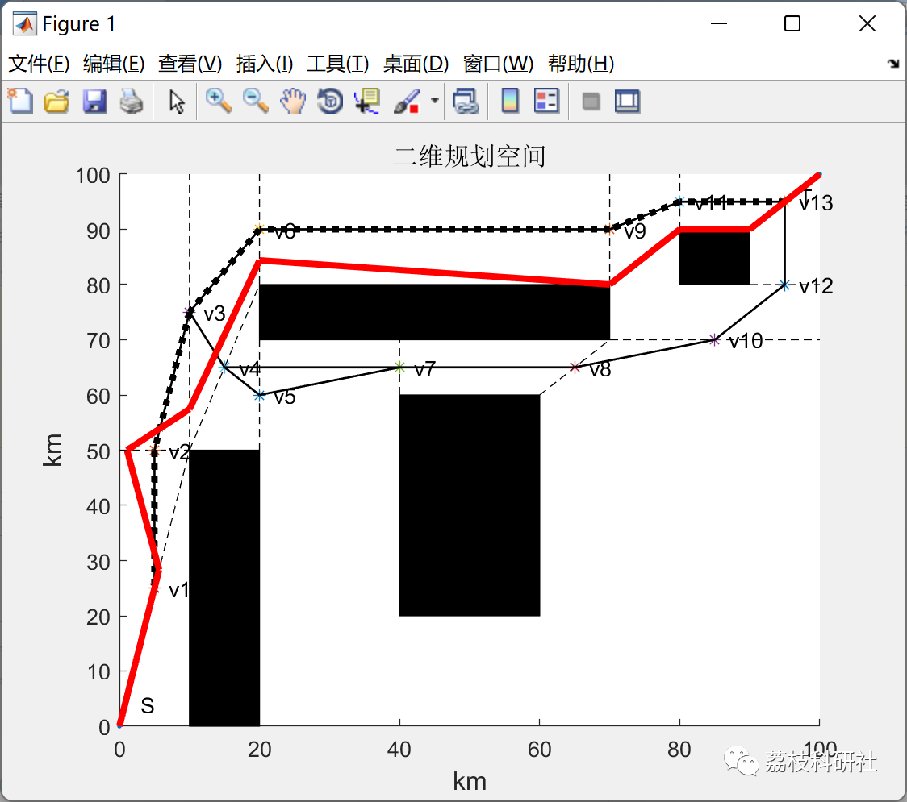
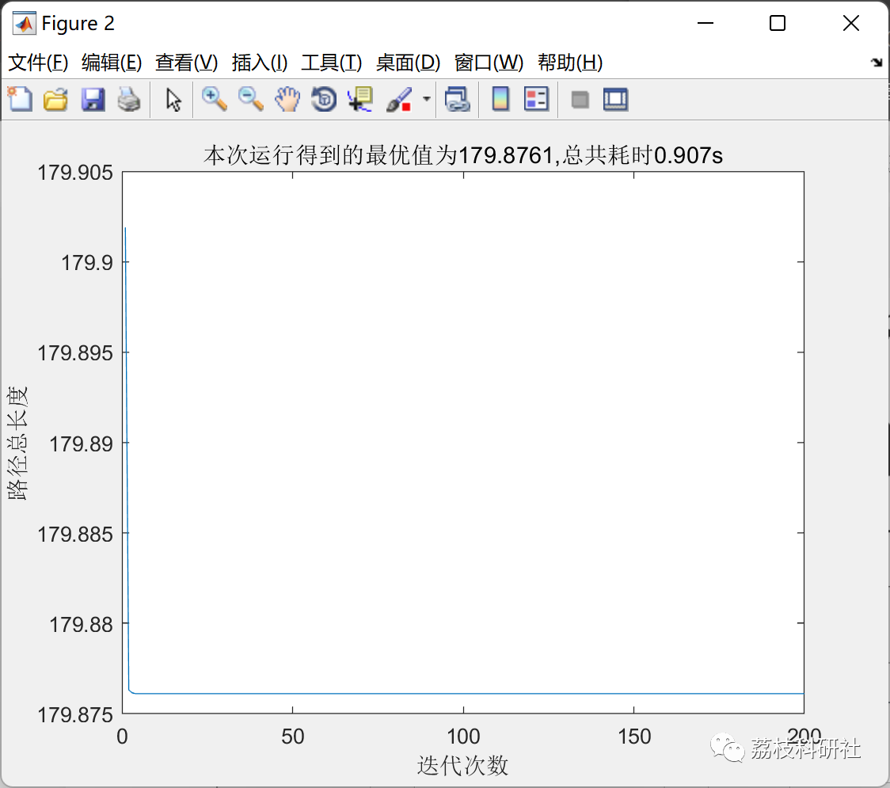
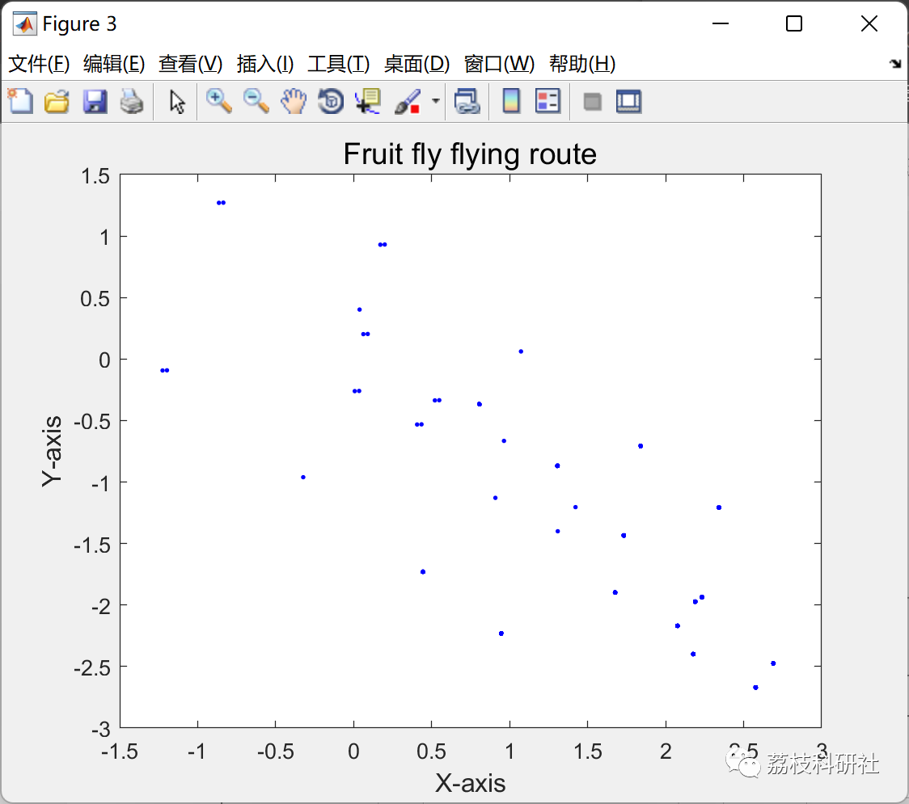
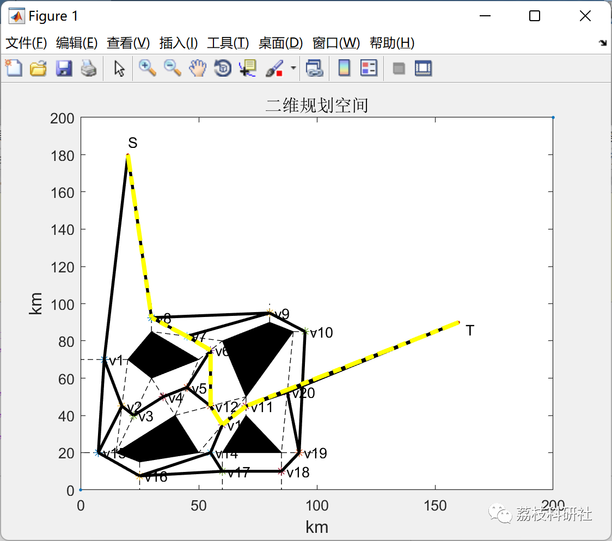

# Path Planning Based on Artificial Potential Field Method and Drosophila Optimization Algorithm (Matlab Code Implementation)

💥💥💥💞💞💞💞 Welcome to this blog❤️❤️❤️💥💥💥
🏆 Bloggers' Advantage: 🌞🌞🌞 The content of the blog strives to be rigorous in thought and clear in logic, for the convenience of readers.
⛳️ Mantra: The journey of a hundred miles is half done in the last ninety.
Litchi Research Society
Code Collection: Power System, Intelligent Algorithms and Applications, Neural Network Prediction, Path Planning, Optimized Scheduling, Workshop Scheduling, Image Processing, Signal Processing...
🎁Column Directory Link:
🌈🌈🌈🌟🌟🌟🛫🛫🛫🛫🛫🛫🛫🛫🛫🛫🛫🛫🛫🛫🛫🛫🛫🛫🛫🛫🛫🛫🛫🛫🛫🛫🛫🛫🛫🛫🛫🛫🛫🛫🛫🛫🛫🛫🛫🛫🛫🛫🛫🛫🛫🛫🛫🛫🛫🛫🛫🛫🛫🛫🛫🛫🛫🛫🛫🛫🛫🛫🛫🛫🛫🛫🛫🛫🛫🛫🛫🛫🛫🛫🛫🛫🛫🛫🛫🛫🛫🛫🛫🛫🛫🛫🛫🛫🛫🛫🛫🛫🛫🛫🛫🛫🛫🛫🛫🛫🛫🛫🛫🛫🛫🛫🛫🛫🛫🛫🛫🛫🛫🛫🛫🛫🛫🛫🛫🛫🛫🛫🛫🛫🛫🛫🛫🛫🛫🛫🛫🛫🛫🛫🛫🛫🛫🛫🛫🛫🛫🛫🛫🛫🛫🛫🛫🛫🛫🛫🛫🛫🛫🛫🛫🛫🛫🛫🛫🛫🛫🛫🛫🛫🛫🛫🛫🛫🛫🛫🛫🛫🛫🛫🛫🛫🛫🛫🛫🛫🛫🛫🛫🛫🛫🛫🛫🛫🛫🛫🛫🛫🛫🛫🛫🛫🛫🛫🛫🛫🛫🛫🛫🛫🛫🛫🛫🛫🛫🛫🛫🛫🛫🛫🛫🛫🛫🛫🛫🛫🛫🛫🛫🛫🛫🛫🛫🛫🛫🛫🛫🛫🛫🛫🛫🛫🛫🛫🛫🛫🛫🛫🛫🛫🛫🛫🛫🛫🛫🛫🛫🛫🛫🛫🛫🛫
💥1 Overview
In recent years, intelligent robots have gradually been applied in numerous fields such as healthcare and aviation. Path planning, as a key technology for robots to achieve intelligent autonomous planning, has received widespread attention from many scholars. Its specific meaning refers to the ability of mobile robots to plan an effective path without collisions in a real space environment with obstacles. Path planning can be categorized into static and dynamic path planning based on the degree of available external environmental information. In practical cases, according to the performance of algorithms, dynamic path planning algorithms have poor real-time performance and are more complex to implement. Under existing technological conditions, it is difficult to ensure high precision in search results.
📚2 Running Results
📃2.1 Example 1
Robot Path Planning Based on Artificial Potential Field Method: Randomly generate 12-15 obstacles, each of which randomly occupies 6-23 grids. The robot's path planning from the bottom left to the top right is implemented using this artificial potential field method. Additionally, dynamic display effects have been implemented in the code.
📃2.2 Example 2
Path Planning Based on Drosophila Optimization Algorithm: Implement global path planning for a single robot based on the provided map. Additionally, extend the part to dual-robot path planning, where two robots move from the bottom left to the top right and vice versa.
🎉3 References
[1] Bao Jiusheng, Zhang Muye, Ge Shirong, Liu Qin, Yuan Xiaoming, Wang Maosen, Yin Yan, Zhao Liang. Path Planning for Unmanned Vehicles in Underground Mines Based on Improved A* and Artificial Potential Field Algorithms [J]. Coal Journal, 2022, 47(3): 1347-1360  
[2] Wen Shuhui, Wei Zeteng, Liu Xin, Wen Shuhuan. Autonomous Map Construction and Path Planning for Mobile Robots Based on ROS [J]. Shenyang University of Technology Journal, 2022, 44(1): 90-94​  
👨‍💻4 Matlab Code to Implement  
Click the article's lower left corner to read the full text.

## Images

<!-- PAYMENT_BLOCK -->

## Get this dataset

- Payment link (Stripe): [Buy now](https://buy.stripe.com/3cs8yP7sY87d0vu9AB)
- Payment QR code: 

<!-- /PAYMENT_BLOCK -->
